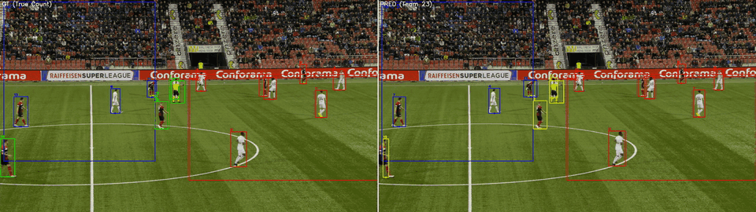

# Soccer Player Tracking & Behavior Analysis

Multi-object tracking of soccer players in broadcast footage, combining a fine-tuned **YOLO11l** detector, the **BoT-SORT** tracker with a fine-tuned **OSNet** Re-Identification model, and an offline trajectory post-processing stage.

Developed as a group project for the *Artificial Vision* course (MSc in Computer Engineering, University of Salerno, A.Y. 2025-2026), as an entry to the Soccer Video Understanding contest organized by the MIVIA Lab. **The pipeline ranked 2nd out of ~30 teams (PTBS 1.8888, HOTA@0.5 0.904).**

<p align="center">
  
</p>
<p align="center"><sub>Left: ground truth. Right: our predictions. Box colors show ROI membership, numbers are track IDs.<br>Qualitative example on a SoccerNet test clip, generated with an early version of the pipeline (before the ReID fine-tuning and post-processing stages).</sub></p>

## Results

Official contest leaderboard (hidden test set prepared by the organizers, ~30 teams):

| Rank | PTBS | HOTA@0.5 | nMAE score | MAE |
|---|---|---|---|---|
| **2nd** | **1.8888** | **0.9039** | **0.9849** | **0.1505** |

PTBS = HOTA@0.5 + nMAE score. The winning team scored 1.8892, a gap of 0.0004.

In our own evaluation before the contest, the pipeline reached HOTA@0.5 = 0.812 and nMAE score = 0.946 (PTBS = 1.758); see the [report](docs/report.pdf).

Component-level results:

| Model | Task | Metric |
|---|---|---|
| YOLO11l, fine-tuned @ 1920 px | Player detection | mAP@50 = 0.981, mAP@50-95 = 0.693, P = 0.962, R = 0.937 |
| OSNet x1.0, fine-tuned (triplet loss) | Player Re-ID | mAP = 81.7%, Rank-1 = 96.5%, Rank-5 = 98.0% |

## The task

1. **Player tracking**: detect every player in each frame and keep a consistent identity across the clip, despite camera pans and zooms, motion blur, occlusions and teammates wearing identical kits. Evaluated with HOTA@0.5.
2. **Behavior analysis**: count, frame by frame, how many players stand inside two rectangular Regions of Interest. A player is inside a region if the bottom-center of their bounding box (their feet) falls inside it. Evaluated with a normalized MAE score.

## Pipeline

```
frames ──► YOLO11l detector ──► BoT-SORT tracker ──► ROI counting ──► offline post-processing ──► tracking + behavior files
                                  ▲          ▲                         (stitching, interpolation,
                       OSNet ReID ┘          └ camera-motion            smoothing, cleanup)
                       embeddings              compensation
```

- **Detection**: YOLO11l chosen after comparing YOLOv8m/l and YOLO11m/l. Fine-tuned on SoccerNet Tracking at the native 1920 px resolution, which is critical for small, distant players. Only human classes (players, goalkeepers, referees) are kept: the ball is filtered out.
- **Tracking**: BoT-SORT (via [BoxMOT](https://github.com/mikel-brostrom/boxmot)) with a long track buffer (250 frames = 10 s) to survive long occlusions, and strict appearance matching to limit ID switches between similar-looking teammates.
- **Re-Identification**: OSNet x1.0 fine-tuned with triplet loss on player crops extracted from SoccerNet (Market-1501-style dataset, query/gallery split for validation). It outperformed the YOLOv8n-based ReID features we tested.
- **Post-processing** (`src/post_processing.py`): merges fragmented tracklets that are close in space and time, linearly interpolates gaps of up to 15 frames, smooths trajectories with a Savitzky-Golay filter and removes tracks shorter than 2 s. This makes the system *offline* by design: accuracy was prioritized over latency.

The full methodology and the design choices are described in the [project report](docs/report.pdf).

## Design trade-offs

- **Offline by design**: trajectory stitching, interpolation and smoothing use future frames, so the full pipeline is not real-time. We traded latency for accuracy, since the contest ranked systems only by PTBS. The online part (detection + BoT-SORT) can run on its own if latency matters.
- **High input resolution**: running the detector at 1920 px is key for small, distant players, but it raises compute cost (a GPU is needed for reasonable speed).

## Repository structure

```
├── run_pipeline.py                  # inference: detection → tracking → ROI counting → post-processing
├── src/
│   ├── tracker.py                   # BoT-SORT + OSNet wrapper with the tuned hyperparameters
│   ├── post_processing.py           # offline trajectory cleaning (SoccerTrackCleaner)
│   └── roi_utils.py                 # ROI geometry helpers
├── notebooks/
│   └── soccer_tracking_pipeline.ipynb   # end-to-end Colab notebook: data prep, training, inference, visualization
├── results/
│   ├── detector/                    # YOLO training curves, PR/F1 curves, confusion matrix, sample predictions
│   └── reid/                        # OSNet fine-tuning log
└── docs/report.pdf                  # project report
```

## Getting started

### 1. Install

```bash
git clone <this-repo-url>
cd soccer-player-tracking
pip install -r requirements.txt
```

A CUDA GPU is strongly recommended: the detector runs at 1920 px.

### 2. Download the fine-tuned weights

Download `yolov11l_finetuned_best.pt` and `osnet_x1_0_finetuned_best.pt` from the [Releases page](../../releases) and place them in `weights/`.

### 3. Prepare the data

The models were trained on [SoccerNet Tracking 2023](https://www.soccer-net.org/), which is not redistributed here. You can download it with the `SoccerNet` package (see the first cell of the notebook). The pipeline expects one folder per clip:

```
data/test/
└── <video_id>/
    ├── img1/000001.jpg ...
    └── roi.json          # optional: {"roi1": {"x", "y", "width", "height"}, "roi2": {...}} in normalized coordinates
```

### 4. Run

```bash
python run_pipeline.py --data-dir data/test --output-dir predictions --weights-dir weights
```

For each clip it writes `tracking_<id>_23.txt` (`frame,id,x,y,w,h`) and `behavior_<id>_23.txt` (`frame,roi_id,count`).

The official contest evaluator was provided by the course staff and is not included. If you have it, place `simulator.py` and `evaluation_helper.py` in `evaluation/` and add `--evaluate`.

### Training

Training was done on Google Colab (T4 GPU). The notebook covers the whole workflow: dataset download and train/validation/test split, conversion to YOLO format, detector fine-tuning, ReID dataset generation and OSNet fine-tuning, inference, post-processing, evaluation and the side-by-side visualization used for the demo above.

## Tech stack

Python · PyTorch · Ultralytics YOLO11 · BoxMOT (BoT-SORT) · Torchreid (OSNet) · TrackEval · OpenCV · pandas · SciPy · Google Colab

## Authors

Group project (Group 23). Repository maintained by **Raffaele Rosanova**.

## Acknowledgements

- [SoccerNet](https://www.soccer-net.org/) for the tracking dataset. The released model weights were trained on SoccerNet data and are subject to its terms of use.
- MIVIA Lab, University of Salerno, for organizing the contest and providing the evaluation tools.
- [Ultralytics](https://github.com/ultralytics/ultralytics), [BoxMOT](https://github.com/mikel-brostrom/boxmot), [Torchreid](https://github.com/KaiyangZhou/deep-person-reid) and [TrackEval](https://github.com/JonathonLuiten/TrackEval).
